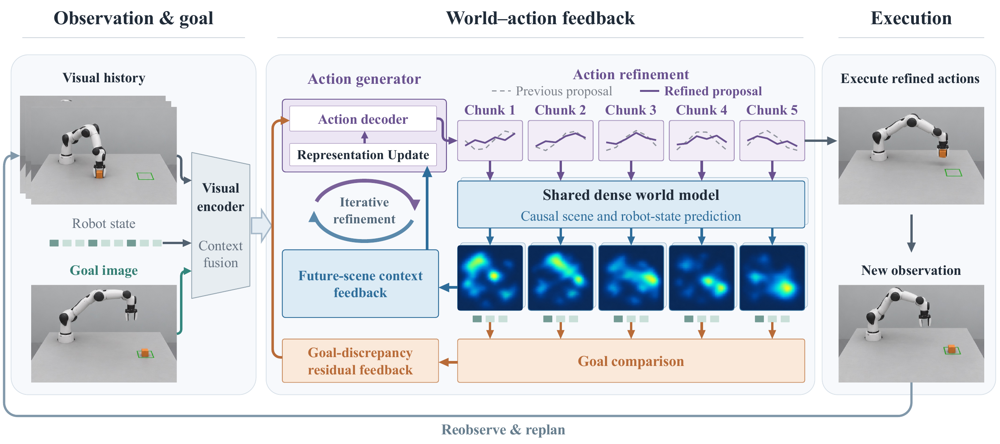
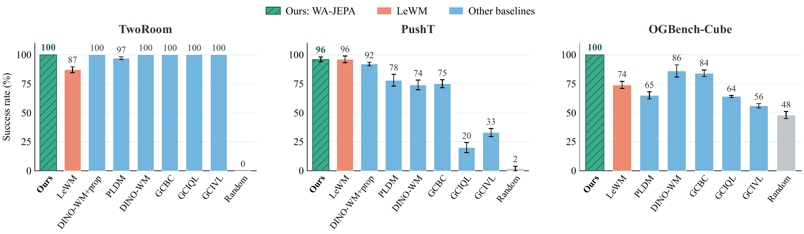
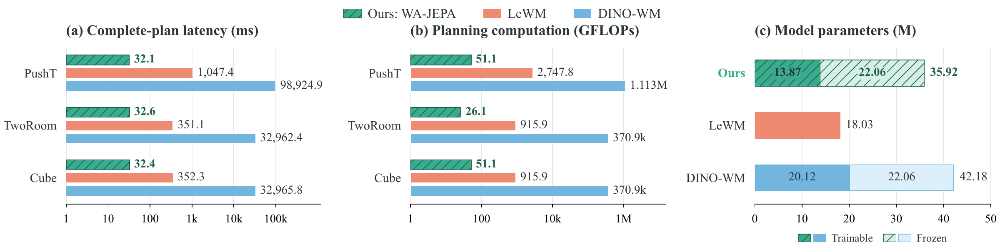

# WA-JEPA

Code for **WA-JEPA**, including short-horizon goal reaching on **PushT, TwoRoom, and OGBench-Cube**, and full-task execution on **Push-T and LIBERO-Goal**.

This release contains the networks, training objectives, deployment policies, data preparation, and evaluation entry points. Long-horizon AP planning code, datasets, checkpoints, and experiment logs are not included.

## Full-task code

Training and evaluation for **Push-T and LIBERO-Goal** with the paper's **VQ-BeT action head** are now available in [`fulltask/`](fulltask). See the [full-task guide](docs/fulltask.md) for the separate environment, dataset preparation, codebook pretraining, multi-GPU launchers, optional fine-tuning, and evaluation.

## Framework



**Fig. 1. WA-JEPA overview.** The model refines the same action plan before execution through action proposal, future prediction, and goal-aware feedback. Goal-discrepancy residual feedback guides chunk-wise corrections; future-scene context feedback provides detailed predicted scene information for action refinement.

## Short-horizon results



**Fig. 2. Goal-reaching performance.** WA-JEPA achieves 100%, 96%, and 100% success on TwoRoom, PushT, and Cube, respectively, under the paper's short-horizon evaluation protocol.



**Fig. 3. Computational cost on an NVIDIA A40.** Complete-plan latency and neural computation use logarithmic axes. The parameter comparison uses a linear axis and distinguishes trainable and frozen parameters.

## Full-task results

**Tab. 2. Full-task performance and computational cost.** Push-T reports final coverage and LIBERO-Goal reports task success, both as percentages (mean ± available standard deviation). Bold marks the best values within each task.

| Method | Head | Push-T (%) ↑ | LIBERO-Goal (%) ↑ | Params. (M) ↓ | Mem. (MiB) ↓ | FLOPs (G) ↓ | Latency (ms) ↓ |
|:---|:---|---:|---:|---:|---:|---:|---:|
| WebSSL (CLS) | VQ-BeT | 59 ± 1 | 95 ± 1 | 332.7 / 308.0 | 665.0 / 647.3 | 162.5 / 324.6 | 19.20 / 17.49 |
| Patch Policy | VQ-BeT | 68 ± 3 | 94 ± 1 | 334.0 / 308.7 | 894.5 / 2552.6 | 255.2 / 413.5 | 26.49 / 81.35 |
| ResNet-18 Patch | ACT | 64 ± 3 | 93 ± 2 | 66.5 / 66.7 | 144.0 / 152.6 | **6.1** / **11.9** | **11.87** / **12.01** |
| OpenVLA-OFT | MLP | 59 ± 2 | 95 | 7608.4 / 7709.2 | 14837.7 / 15331.6 | 4202.6 / 8766.6 | 91.13 / 147.16 |
| Fast-WAM | Flow matching | — | 96 | 12406.3 | 23959.7 | 2545.1 | 438.53 |
| RynnVLA-002 | Regression | — | 96 | 7150.3 | 15429.3 | 16297.3 | 436.55 |
| DreamVLA | Diffusion | — | 86 | 734.0 | 1515.7 | 1001.8 | 85.77 |
| **WA-JEPA** | VQ-BeT | **71 ± 2** | **97 ± 1** | **37.2** / **37.8** | **92.2** / **115.6** | 13.5 / 26.5 | 27.21 / 26.95 |

Cost pairs follow **Push-T / LIBERO-Goal**; a single cost value refers to **LIBERO-Goal only**. “—” denotes an unreported result. Costs are measured on an NVIDIA A40 with BF16 and batch size 1. Memory is peak allocated GPU memory; latency covers one complete online planning call that generates an action chunk. Full-task training and evaluation instructions are provided in the [full-task guide](docs/fulltask.md).

## Short-horizon installation

The tested setup is Linux, Python 3.10, an NVIDIA A40, CUDA 12.1 PyTorch wheels, and BF16. Training and evaluation expect a CUDA GPU; macOS can be used to edit the source.

```bash
python3.10 -m venv .venv
source .venv/bin/activate
python -m pip install --upgrade pip
python -m pip install torch==2.5.1 torchvision==0.20.1 --index-url https://download.pytorch.org/whl/cu121
python -m pip install -r requirements.txt
export MUJOCO_GL=egl
export MPLBACKEND=Agg
```

The requirements record the principal packages in the tested environment, rather than a lockfile of every transitive dependency. The code was checked in the existing experiment environment; installation in a completely new environment has not been tested.

### Frozen visual encoder

Obtain the official [DINOv2](https://github.com/facebookresearch/dinov2) code and ViT-S/14 pretrained weights:

```bash
mkdir -p third_party pretrained
git clone https://github.com/facebookresearch/dinov2.git third_party/dinov2
curl -fL https://dl.fbaipublicfiles.com/dinov2/dinov2_vits14/dinov2_vits14_pretrain.pth \
  -o pretrained/dinov2_vits14_pretrain.pth
export DINO_REPO="$PWD/third_party/dinov2"
export DINO_CHECKPOINT="$PWD/pretrained/dinov2_vits14_pretrain.pth"
```

The experiment's pretrained weight SHA-256 is `b938bf1bc15cd2ec0feacfe3a1bb553fe8ea9ca46a7e1d8d00217f29aef60cd9`. DINOv2 stays frozen. xFormers was not installed in the checked environment and is not required. Run commands from this repository's root. The two environment variables also relocate paths stored in older checkpoints without changing their learned tensors.

## Data

Use the short-horizon datasets distributed with [LeWorldModel](https://github.com/lucas-maes/le-wm) through its [data collection](https://huggingface.co/collections/quentinll/lewm). These are the goal-reaching benchmark datasets; do not substitute the full-task Push-T imitation-learning dataset.

Arrange the extracted data as follows:

```text
data/
└── datasets/
    ├── pusht_expert_train.h5
    ├── pusht_expert_train.lance/  # derived training copy
    ├── tworoom.h5
    └── ogbench/
        └── cube_single_expert.h5
```

PushT training uses the Lance reader; evaluation uses the original HDF5 file. Convert once, retaining the HDF5 file:

```bash
python prepare_pusht.py --dataset-root data
```

The converter uses the installed stable-worldmodel writer (JPEG quality 95) and refuses to overwrite an existing Lance table. Reuse the original converted training copy when reproducing an existing run exactly; conversion is not lossless. TwoRoom and Cube use HDF5 directly. All scripts accept `--dataset-root`; its value is the **parent of `datasets/`**, not the `datasets/` directory itself. `LOCAL_DATASET_DIR` is also accepted by training/evaluation entry points.

## Training

| Setting | PushT | TwoRoom | Cube |
|---|---:|---:|---:|
| Epochs | 20 | 10 | 10 |
| Batch size | 512 | 128 | 128 |
| Observation history | 3 | 1 | 3 |
| Action dimension per step | 2 | 2 | 5 |
| Proprioceptive dimension | 4 | 2 | 19 |
| Training/validation split | Episode-level 90/10 | Mapped random windows 90/10 | Mapped random windows 90/10 |

Shared defaults: seed 3072, AdamW, learning rate `5e-5`, weight decay `1e-3`, gradient clipping at 1.0, BF16, five action chunks of five steps, four proposals with three feedback updates, eight scene tokens, and a three-layer world model. Each task is trained from scratch apart from the frozen DINOv2 encoder.

```bash
python train_pusht.py --dataset-root data --run-dir runs/pusht
python train_tasks.py --task tworoom --dataset-root data --run-dir runs/tworoom
python train_tasks.py --task cube --dataset-root data --run-dir runs/cube
```

Run these separately, or assign different GPUs through `CUDA_VISIBLE_DEVICES`. These are single-GPU training entry points. Use a new output directory for each run; existing runs are not overwritten. Changing `--batch-size` changes the experimental configuration.

TwoRoom/Cube evaluate the new checkpoint after every epoch in a separate process. Pass `--skip-eval` to evaluate later. PushT saves one checkpoint per epoch; use the evaluation command below for each checkpoint. `--resume-weights` in `train_pusht.py` loads model weights only, not optimizer/scheduler state; it is not an exact interrupted-run resume.

### Fidelity to the original short-horizon experiments

- PushT uses an episode-level split. TwoRoom/Cube reproduce the original random-window split, then filter starts without enough future observations; they are **not episode-disjoint splits**.
- Normalization statistics are computed with the original full-dataset procedure.
- The goal curriculum keeps the 25-step goal with probability 0.5 and otherwise samples uniformly from the five chunk endpoints. Actions after a sampled early goal are masked as in the original trainer.
- History dropout is disabled for TwoRoom's single-frame input. PushT/Cube use probability 0.25.
- The training objectives and auxiliary heads are retained as used in the experiments. Auxiliary predictions do not rank candidate actions in the default deployment policy.
- PushT retains its LambdaLR warmup/cosine schedule. TwoRoom/Cube retain stable-pretraining's `LinearWarmupCosineAnnealingLR`, advanced on every optimizer step. These schedules have not been unified.

## Short-horizon evaluation

The default protocol uses **50 cases**, seed **42**, a target **25 environment steps** ahead, and a maximum execution budget of **50 steps**. The model generates five five-step chunks, executes the buffered plan, and replans when the buffer is empty; an episode can terminate earlier on success. No candidate-action search or high-level planner is used.

```bash
python eval_pusht.py --checkpoint runs/pusht/weights_epoch_20.pt \
  --dataset-root data --result-dir results/pusht_epoch20 --no-video
python eval_tasks.py --task tworoom --checkpoint runs/tworoom/weights_epoch_10.pt \
  --dataset-root data --run-dir results/tworoom_epoch10
python eval_tasks.py --task cube --checkpoint runs/cube/weights_epoch_10.pt \
  --dataset-root data --run-dir results/cube_epoch10
```

The epoch numbers above are command examples, not instructions to use the final checkpoint as the best checkpoint. Evaluate the desired checkpoints and identify the selected epoch in any reported result. Results are written to JSON, with per-case success flags and the case-selection metadata. `success_rate` follows stable-worldmodel's percentage scale (0–100).

Evaluation preserves the benchmark's original `len(valid)-1` case-sampling convention. Simulator state is used to restore initial conditions and goals, not as network input. The network receives images and agent/robot proprioception. Cube preserves the seven proprioceptive column names and their concatenation order from training.

`--inference-batch-size` controls only how many environments are forwarded through the network together (default 8); it does not change the number of evaluated environments. TwoRoom/Cube validate the initial proprioception and cross-check terminal success against the physical environment state.

## Source map

| File | Role |
|---|---|
| `wa_jepa.py` | Frozen visual encoder, representation fusion, action proposals, world model, two feedback paths |
| `wa_policy.py` | Observation history and action buffering for environment execution |
| `train_pusht.py` | Shared training losses and PushT training |
| `train_tasks.py` | TwoRoom/Cube data preparation, original split and training loop |
| `eval_pusht.py` / `eval_tasks.py` | Short-horizon environment evaluation |
| `runtime_utils.py` | Dataset, hashing, inference microbatching, and training utilities |
| `task_evaluation.py` | Per-epoch evaluation subprocess |
| `config/eval/` | TwoRoom/Cube evaluation protocols |
| `prepare_pusht.py` | PushT data conversion |

The public model and policy are `WorldActionJEPA` and `WorldActionRecedingHorizonPolicy`. New checkpoints use the `wa_jepa` format; existing experiment checkpoints remain loadable without conversion.

## Acknowledgments

This release was extracted from the WA-JEPA implementation developed in the [LeWorldModel](https://github.com/lucas-maes/le-wm) codebase. It uses [stable-worldmodel](https://github.com/galilai-group/stable-worldmodel), [stable-pretraining](https://github.com/galilai-group/stable-pretraining), and [DINOv2](https://github.com/facebookresearch/dinov2). The existing upstream MIT notice is preserved in `LICENSE`; external dependencies and pretrained assets retain their respective licenses. See [third-party notices](THIRD_PARTY_NOTICES.md).
