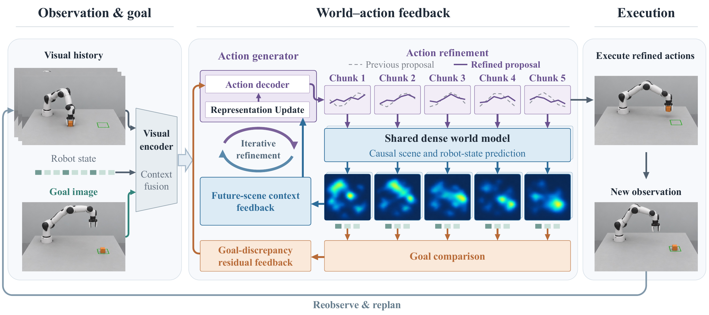
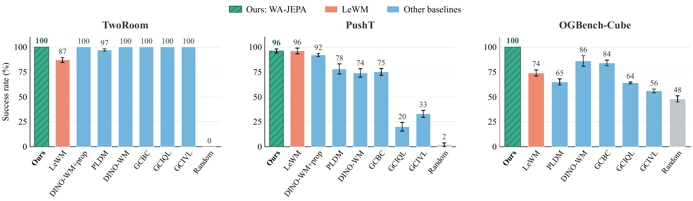
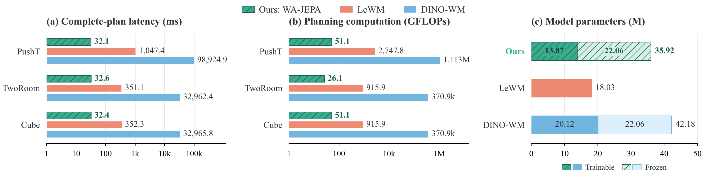

# WA-JEPA 短期任务代码

本目录只包含 **WA-JEPA 短期目标到达实验**：PushT、TwoRoom、OGBench-Cube。网络结构、训练目标及两条反馈路径均保留。完整任务动作头、LIBERO、长期 AP 规划、其他架构变体、数据、权重和日志均未包含。

## 网络框架

**图 1：WA-JEPA 总体框架。** 模型通过动作提案、未来预测与目标感知反馈，在执行前迭代修正同一动作计划。目标差异残差反馈指导逐 chunk 的动作调整，未来场景上下文反馈为动作修正提供更细致的预测场景信息。

## 短期任务实验

**图 2：目标到达表现。** 在论文的短期评测设置下，WA-JEPA 在 TwoRoom、PushT 和 Cube 上分别取得 100%、96% 和 100% 的成功率。

**图 3：NVIDIA A40 上的计算开销。** 完整计划生成延迟与神经网络计算量采用对数轴；参数量采用线性轴，并区分可训练参数与冻结参数。

详细安装、数据格式、训练及评测命令见 [README.md](README.md)。在仓库根目录运行命令。训练/评测需要 Linux CUDA 环境，本地 Mac 可用于编辑和上传代码。

- 网络：`wa_jepa.py`；实际执行策略：`wa_policy.py`。
- PushT 训练：`train_pusht.py`，默认 batch 512、20 epochs。
- TwoRoom/Cube 训练：`train_tasks.py --task tworoom/cube`，默认 batch 128、10 epochs。
- 评测：`eval_pusht.py`、`eval_tasks.py`，默认 50 个案例、目标间隔 25 步、执行预算 50 步。
- 数据路径传给 `--dataset-root`，该路径下面应有 `datasets/` 子目录。
- DINO 源码和预训练权重通过 `DINO_REPO`、`DINO_CHECKPOINT` 指定，旧权重内的服务器路径可以被这两个变量覆盖。

原训练/评测脚本的计算逻辑已迁入独立入口，不再依赖旧版本网络、服务器历史日志或私有参考配置。保留了原实验的数据划分差异和随机数消耗；这些细节在英文 README 中有说明。全部输出请使用新目录，避免覆盖已有结果。

本目录可独立维护；`.gitignore` 已排除数据、权重、日志和缓存。

## TODO

- [x] 发布 PushT、TwoRoom、OGBench-Cube 短期目标到达代码。
- [ ] **即将发布：**长期任务代码，包括高层中间目标规划与评测流程。
- [ ] **即将发布：**Push-T、LIBERO-Goal 完整任务训练与评测代码，包括动作头适配及任务配置。
